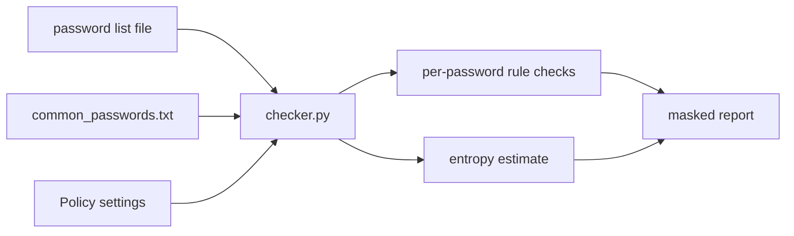

# Password Policy Checker

Weak passwords are a common cause of account compromise. This tool checks a list of passwords against a configurable policy (length, character classes, a small bundled common-password list) and gives a rough entropy estimate, so you can see how a policy treats different choices.

> Portfolio project. Uses simulated/sample data only.

## Architecture



## Setup

```bash
git clone https://github.com/AJJudkins/password-policy-checker.git
cd password-policy-checker
# Python 3.9+, standard library only
```

## Usage

```bash
python checker.py sample_data/sample_passwords.txt
python checker.py sample_data/sample_passwords.txt --min-length 14 --json
```

## Sample output

```text
#1   ********             len=8   entropy=37.6   FAIL too_short, no_uppercase, no_digit, no_symbol, common_password, low_entropy
#2   **********           len=10  entropy=59.5   FAIL too_short, no_symbol
#3   *******              len=7   entropy=42.8   FAIL too_short, no_uppercase, low_entropy
#4   *********************** len=23  entropy=151.1  PASS 
#5   ******               len=6   entropy=28.2   FAIL too_short, no_uppercase, no_digit, no_symbol, common_password, low_entropy
#6   ********************* len=21  entropy=138.0  PASS 
#7   *******************  len=19  entropy=89.3   FAIL no_uppercase, no_digit, no_symbol

2/7 passed
```

## Tests

```bash
pip install -r requirements-dev.txt
pytest
```

## What this demonstrates

- Policy-as-code with a small dataclass and testable rule functions
- Privacy-minded design: passwords are never printed or logged; output shows only a masked placeholder, length and entropy
- Basic security concepts: complexity rules, common-password blocklists, entropy
- Clean CLI with text and JSON output, and pytest coverage

## Limitations

- All passwords in `sample_data` are fake. Do not feed real passwords to any tool you have not reviewed.
- Masked output still reveals each password's length.
- Entropy is a crude `length x log2(character pool)` upper bound. It overrates predictable patterns like `Summer2024!`; it is not a substitute for a real estimator such as zxcvbn.
- The bundled common-password list has only 14 entries; real use needs a much larger list.
- Does not follow any specific standard (e.g. NIST 800-63B) out of the box.

## License

MIT
